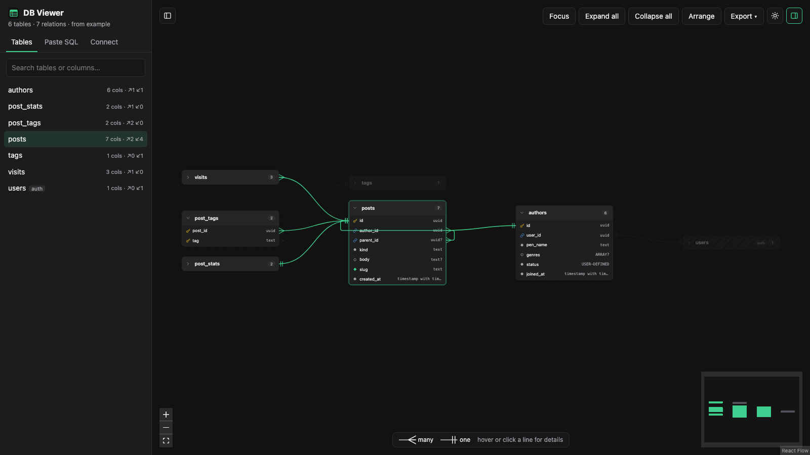
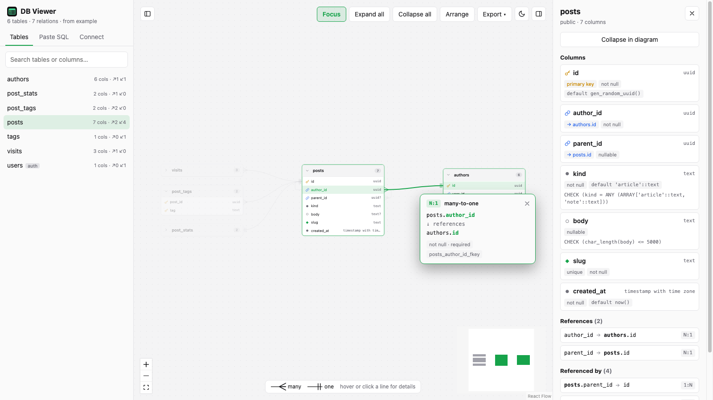

#  DB Viewer

**Paste SQL, get an ER diagram.** Explore a Postgres or Supabase schema as an interactive diagram, right in your browser.

**[Open DB Viewer →](https://ameeramjed.github.io/db-viewer/)**



## Features

- **Paste, drop or import SQL.** Paste `CREATE TABLE` statements, drag a `.sql` file onto the page, or pick one with **Import .sql file**. Reads Supabase's "Schema for context" export, `pg_dump` output and migrations. Not sure where to start? Hit **Load example**.
- **Tables you can expand.** Tables start collapsed; open one to see every column with its type, primary and foreign keys, unique and nullable markers.
- **Relations at a glance.** Foreign keys are drawn as lines with crow's-foot ends, so you can tell **many-to-one** from **one-to-one** without reading anything.
- **Hover or click a line** to see exactly which columns it connects, its type, whether it's optional and its constraint name. Clicking pins the card so it stays open.
- **Focus mode.** Select a table and press **F** to hide everything that isn't related to it; the related tables are pulled close together. Press **F** again and the full diagram returns exactly as you left it.
- **Details panel.** Every column's default, CHECK rule and flags, plus clickable *References* and *Referenced by* lists to jump around the schema.
- **Search** tables and columns from the sidebar.
- **Export and copy.** Download as PNG, SVG, SQL, [Mermaid](https://mermaid.js.org/syntax/entityRelationshipDiagram.html), [DBML](https://dbml.dbdiagram.io/) or JSON, or copy the image, SQL, Mermaid or DBML to the clipboard. In focus mode, only what's on screen is exported.
- **Light and dark themes**, and both side panels can be hidden for a full-screen diagram.
- **Private by design.** Everything runs in your browser. Your SQL is never uploaded anywhere; it's only remembered in your own browser so it's still there next time.



## Keyboard shortcuts

| Key | Action |
|---|---|
| <kbd>F</kbd> | Toggle focus mode |
| <kbd>[</kbd> | Show / hide the sidebar |
| <kbd>]</kbd> | Show / hide the table details panel |
| <kbd>Esc</kbd> | Unpin a relation card |

## Getting your Supabase schema

In the Supabase dashboard's **Schema Visualizer**, use **Copy as SQL** and paste the result into DB Viewer (it starts with *"This schema is for context only"*). Any `pg_dump --schema-only` output works too.

## Run it locally

Requires Node.js 20.19+ or 22.12+.

```bash
npm install
npm run dev        # http://localhost:5173
npm test           # parser and exporter tests
npm run build      # production build in dist/
```

Running locally adds a **Connect** tab that loads the schema straight from a Supabase project using its URL and API key. The key is sent only to your local dev server, never stored, and this option isn't available on the hosted site.

## Built with

[React](https://react.dev), [React Flow](https://reactflow.dev), [dagre](https://github.com/dagrejs/dagre) for automatic layout, [html-to-image](https://github.com/bubkoo/html-to-image) for image export and [Vite](https://vite.dev). Deployed to GitHub Pages with GitHub Actions on every push to `main`.

## License

[MIT](LICENSE)
