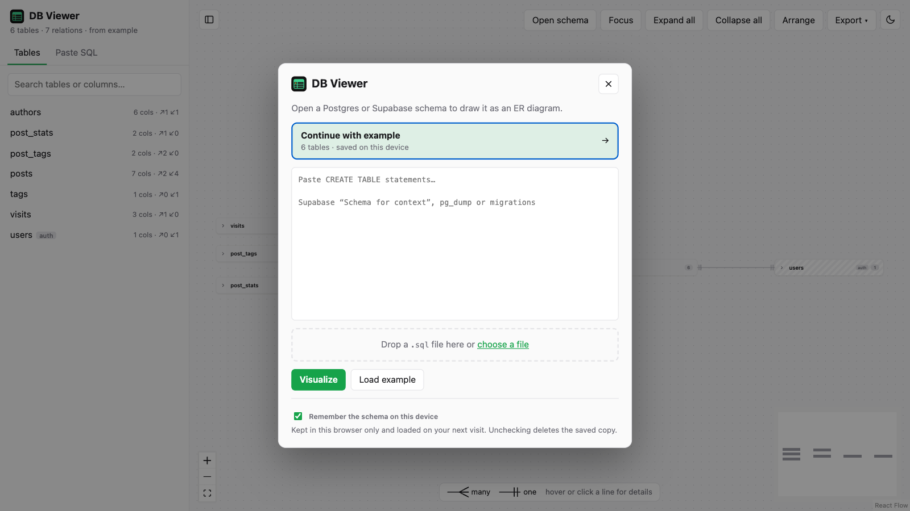
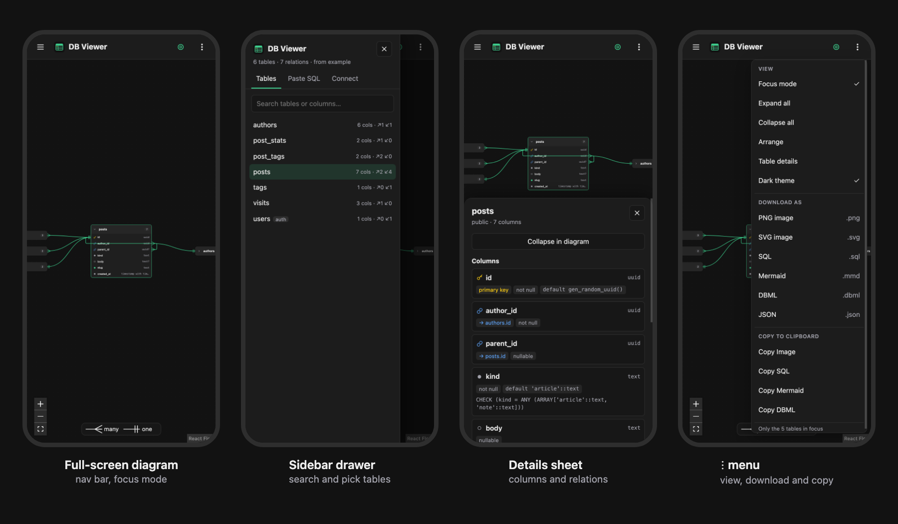

#  DB Viewer

**Paste SQL, get an ER diagram.** Turn a Postgres or Supabase schema into an interactive diagram: explore tables and relations, focus on one table, and export to PNG, SQL, Mermaid or DBML. Free, no sign-up, runs entirely in your browser.

**[Open DB Viewer →](https://ameeramjed.github.io/db-viewer/)**


## Features

- **Start in one step.** DB Viewer opens with a dialog: continue with your last schema, paste `CREATE TABLE` statements, drop or choose a `.sql` file, or hit **Load example**. Reopen it any time with **Open schema**. Reads Supabase's "Schema for context" export, `pg_dump` output and migrations. You can also paste in the sidebar or drop a file anywhere on the diagram.
- **Tables you can expand.** Tables start collapsed; open one to see every column with its type, primary and foreign keys, unique and nullable markers.
- **Relations at a glance.** Foreign keys are drawn as lines with crow's-foot ends, so you can tell **many-to-one** from **one-to-one** without reading anything.
- **Hover or click a line** to see exactly which columns it connects, its type, whether it's optional and its constraint name. Clicking pins the card so it stays open.
- **Focus mode.** Select a table and press **F** to hide everything that isn't related to it; the related tables are pulled close together. Press **F** again and the full diagram returns exactly as you left it.
- **Details panel.** Every column's default, CHECK rule and flags, plus clickable *References* and *Referenced by* lists to jump around the schema.
- **Search** tables and columns from the sidebar.
- **Export and copy.** Download as PNG, SVG, SQL, [Mermaid](https://mermaid.js.org/syntax/entityRelationshipDiagram.html), [DBML](https://dbml.dbdiagram.io/) or JSON, or copy the image, SQL, Mermaid or DBML to the clipboard. In focus mode, only what's on screen is exported.
- **Light and dark themes**, and both side panels can be hidden for a full-screen diagram.
- **Works on your phone** with a touch-friendly layout (see below).
- **Private by design.** Everything runs in your browser and your SQL is never uploaded anywhere. Nothing is saved unless you tick **Remember the schema on this device** in the dialog; untick it to delete the saved copy.




## On your phone

The diagram fills the screen under a compact nav bar. The table list slides in as a drawer, table details open as a bottom sheet, and **Open schema** plus every view, download and copy option lives in the ⋮ menu. Tap a line to pin its details.



## Keyboard shortcuts

| Key | Action |
|---|---|
| <kbd>F</kbd> | Toggle focus mode |
| <kbd>[</kbd> | Show / hide the sidebar |
| <kbd>]</kbd> | Show / hide the table details panel |
| <kbd>Esc</kbd> | Close the start dialog, or unpin a relation card |

## Getting your Supabase schema

In the Supabase dashboard's **Schema Visualizer**, use **Copy as SQL** and paste the result into DB Viewer (it starts with *"This schema is for context only"*). Any `pg_dump --schema-only` output works too.

## Run it locally

Requires Node.js 20.19+ or 22.12+.

```bash
npm install
npm run dev        # http://localhost:5173
npm test           # parser and exporter tests
npm run build      # production build in dist/
```

Running locally adds **Connect Supabase** to the start dialog (and a **Connect** tab to the sidebar), which loads the schema straight from a Supabase project using its URL and API key. Supabase only shares the schema with a **secret** key (`sb_secret_…`) or the legacy `service_role` key; publishable and anon keys are refused. The key is sent only to your local dev server and never stored. A connected schema survives reloading the tab; once the tab is closed, DB Viewer asks you to connect again with the URL already filled in. This option isn't available on the hosted site.

## Built with

[React](https://react.dev), [React Flow](https://reactflow.dev), [dagre](https://github.com/dagrejs/dagre) for automatic layout, [html-to-image](https://github.com/bubkoo/html-to-image) for image export and [Vite](https://vite.dev). Deployed to GitHub Pages with GitHub Actions on every push to `main`.

## License

[MIT](LICENSE)
